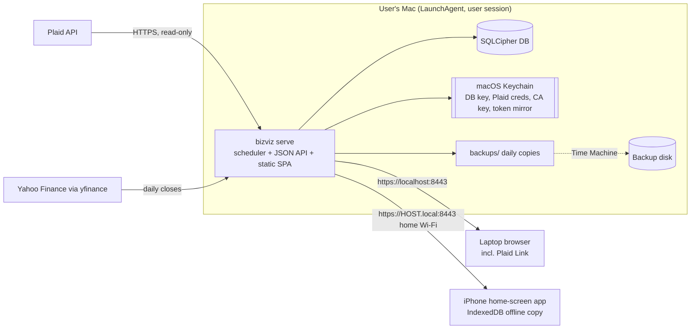

# Architecture

A condensed overview for contributors. User-facing setup is in the [README](../README.md); manual checks are in [manual-test-checklist.md](manual-test-checklist.md).

**Principle: show the truth, never advise.** No recommendations, budgets, scores or forecasts. Where data is stale, pending, estimated or incomplete, the UI says so.

**Priority when trading off:** privacy and security, then correctness and honesty of numbers, then reliability of unattended sync, then performance, then convenience.

## Components

A single Python service runs on the Mac as a per-user LaunchAgent. It syncs from Plaid and Yahoo Finance, stores everything in an encrypted SQLite (SQLCipher) database, derives classification, transfers, recurring charges, investment estimates and net worth, and serves a JSON API plus the built Svelte single-page app over HTTPS. The laptop browser and the iPhone home-screen app (a PWA) run the same UI.



Key decisions: Plaid is the only bank aggregator and the only third party for bank data; storage is only on the Mac (plus the phone's offline copy); there is no server of ours. The user's own Plaid developer account (Trial plan, 10 connections for life) keeps ongoing cost at $0. macOS only for now, with platform code isolated behind interfaces so other systems can be added later.

## Data flow

1. The **scheduler** thread ticks every 60 s and runs one job at a time: Plaid transactions sync, a daily per-item job (holdings, balances, investment transactions), token recovery, price fetch and estimate rebuild, backup, certificate and hostname checks. Network calls happen outside the database write lock; results are then written in a short write unit.
2. After a sync batch, edit, rule change or ownership change, the **classification rebuild** recomputes `tx_classification` and `recurring_groups` as one write unit and bumps `data_version`.
3. The browser or phone calls `GET /api/status` (cheap, polled every 60 s). If `data_version` differs from its cache, it fetches `GET /api/data` (the whole dataset, read in one transaction), renders it, and stores it in IndexedDB.
4. Offline (status call times out), the app renders the cached copy, shows a banner and disables editing. A 401 or logout deletes the cache.
5. Edits go to `PATCH`/`POST` API routes, which write and rebuild synchronously. User corrections are stored separately from Plaid data and are never overwritten by sync.

Plaid has no webhooks here (the Mac has no public URL), so everything is polled. Sleep and wake need no special handling: the first tick after wake finds overdue work.

## Module map

```
src/bizviz/
  __main__.py, cli.py     CLI: setup, serve, demo, status, rotate-cert, uninstall, reset-password
  config.py               paths per env, ports, Keychain names, config.toml
  context.py              AppContext (config, platform, plaid client, db key, clock, request_sync)
  platform/               base.py (Protocols), macos.py, fake.py, selection
  db/                     connection (open_db, write/read units), migrations/NNNN_*.sql, migrate.py
  plaid_types.py          PlaidClient Protocol and errors
  plaid_fake.py           scripted FakePlaidClient for tests
  plaid_client.py         real client over plaid-python
  tokens.py               Keychain token mirror, item index, token recovery
  sync/                   accounts, transactions, investments, daily, linking, errors, due, scheduler
  prices.py               PriceSource Protocol, Yahoo source, price cache refresh
  analytics/              categories, merchant, classify, transfers, recurring,
                          investment_history, networth, dataset, edits
  certs.py                local CA and leaf certificate generation and renewal
  backup.py               daily encrypted backups, retention, restore
  auth.py                 password hashing, sessions, rate limiting
  api/                    FastAPI app factory, routes, security headers
  demo.py                 synthetic dataset for demo mode and tests
web/                      Svelte 5 + Vite + TypeScript SPA (ECharts, service worker, manifest)
tests/                    pytest, with fake Plaid JSON fixtures
scripts/check.sh          full quality gate
```

Plain SQL with DB-API; no ORM. Migrations are numbered `.sql` files, and a backup is written before any pending migration is applied. The `platform/` module keeps everything macOS-specific (Keychain, `launchctl`, `fdesetup`, `tmutil`, `scutil`, certificate trust) behind Protocols, with in-memory fakes for Linux development.

## Counting rules

The classification rebuild is a pure function of the database. Transactions on accounts with `included=0`, and old overlapping transactions of an account superseded by a re-link, are excluded first. Only checking, savings and credit accounts are in the cash-flow views; **Mine** is those marked Mine, **Household** is all of them. Disconnected accounts stay in (their history is real).

Transfers are paired first: an outflow and an inflow in different accounts with the same amount, within 5 days of each other, where at least one side looks like a transfer, never a paycheck. Investment accounts' cash movements count as counterparts. Then each transaction gets a flow and category from, in order: your override, your merchant rule, then these automatic rules:

| Rule | Situation | Counted as |
|---|---|---|
| A | Paired with a transaction in the same scope | Transfer (excluded) |
| B | Paired with a linked account outside this scope (a Joint account seen from Mine) | Spending "To joint account" / earning "From joint account" |
| C | Credit card payment with no matching linked card | Spending "Credit card payment (unlinked card)" |
| D | Loan payment out (other than a card payment) | Spending, "Loan Payments" |
| E | Unpaired transfer to or from savings or investment/retirement funds | Transfer (excluded) |
| F | Money in from loan payments or loan disbursements | Transfer (excluded) |
| G | Money in with an income category | Earning |
| H | Unpaired money in marked as a transfer | Earning "Money in from others" |
| I | Any other money in (a refund) | Spending, as a negative amount |
| J | Unpaired transfer out | Spending "Transfers out" |
| K | Any other money out | Spending |

Some details that matter:

- A user-set category is always kept. Otherwise, a category that does not fit the final flow falls back to Other (spending) or Other Income (earning).
- A rule for a merchant that says "Earning" applies only to money in; Spending, Transfer and Ignore apply both ways.
- Unmatched card payments at an institution that has a linked card are still counted but flagged for review, since they could be double counting.
- Recurring charges are detected per scope from spending transactions: at least 3 occurrences (2 for annual), a steady cadence (weekly, biweekly, monthly, quarterly, annual) and similar amounts. No "next expected" date is shown, because that would be a forecast.
- Net worth is actual balances only: assets (bank, investment) minus debts (cards, loans). An account stops contributing when its connection is removed or Plaid stops reporting it. Points carry a count of accounts whose balance is stale. History starts when accounts are linked.

## Investment estimation

Plaid gives no historical portfolio value, so BizViz estimates it, and always marks it.

- **Anchor:** the first captured holdings snapshot of an account (date `A`). **Window:** the 730 days before `A`. From `A` on, actual balances are recorded and always override estimates.
- **Prices:** Yahoo Finance daily closes. BizViz stores **unadjusted** closes (Yahoo's adjusted close multiplied by later splits), so later splits never invalidate the cache. Splits come from Yahoo's split history; Plaid's split rows are ignored because institutions report them inconsistently.
- **Walk backward** from the anchor: undo each investment transaction (buys, sells, in-kind transfers) and each split, tracking real share counts, and rebuild cash from the account balance. Value of a day = shares times that day's close plus cash.
- **Excluded holdings:** positions without a usable price (no ticker, derivatives, fixed income, failed or inconsistent Yahoo data) are left out of the whole estimate. The UI says how many and how much of today's value they represent.
- **Warnings** are stored and shown: no investment activity reported, activity reported only from some date, inconsistent reported activity, or inconsistent price data.
- No estimate is shown while the item's investment history is still downloading.

## Security model

- **Laptop theft:** FileVault; the app warns if it is off.
- **Database file leaking (backups, copies):** SQLCipher with a 256-bit random key in the Keychain. Backups use the same key. A recovery phrase encodes the key for offline storage.
- **Other devices on the home network:** HTTPS using a local CA. The CA's private key lives only in the Keychain; the leaf certificate is valid 365 days and renews automatically. The dashboard needs a password (scrypt-hashed), with per-device sessions in an `HttpOnly; Secure; SameSite=Strict` cookie, CSRF protection (a required header plus an Origin check) and login rate limits (per IP, plus a global cap; loopback is exempt).
- **Content Security Policy** from the Plaid environment, with a per-request nonce for scripts. Plaid Link is loaded only on `localhost`.
- **Lost iPhone:** iOS Data Protection and the device passcode; no app PIN. Revoke the device in Settings → Devices.
- **Secrets only in the Keychain.** Plaid access tokens are in the encrypted database and mirrored to the Keychain, because each Trial slot is permanent.
- **Logs** contain only IDs, counts, durations and error codes. No access logs; Plaid error bodies are never logged.
- **Sandbox and production never share state:** separate data directory, Keychain service and port.
- Outbound calls: Plaid, Yahoo Finance, and the Plaid Link script from `cdn.plaid.com` (laptop browser only). No telemetry.

Apple's requirements for the certificate (SAN, serverAuth, SHA-2, validity up to 825 days, signed by a CA) are described in [Apple's documentation](https://support.apple.com/en-us/103769). WebKit's storage eviction rules, which are why the iPhone app must be used from the Home Screen, are in [WebKit's tracking prevention notes](https://webkit.org/tracking-prevention/).

## Scheduler cadence

| Job | When |
|---|---|
| Transactions sync | Each healthy connection every 4 h (every 15 min until its history download finishes); broken connections retried every 4 h; transient errors retry after 15 min; "Sync now" and new or repaired connections sync at once |
| Daily item job | Once per local day per connection: holdings, balances, investment transactions. Each step succeeds or fails on its own. Retries wait 30 min (15 min for transient errors) |
| Token recovery | At service start and every 10 min |
| Prices and estimates | When a needed price is missing and has not failed in the last 6 h |
| Backup | If no backup exists for today; the 7 newest are kept |
| Certificate check | Leaf renewed when it expires within 30 days (the service restarts itself); warns when the CA expires within 180 days |
| Hostname check | Reports a mismatch but never changes the certificate automatically |

The scheduler is a single thread in a single-process service (`workers=1`). API requests never run sync jobs inline; they call `request_sync` and return.

Plaid's [Link update mode](https://plaid.com/docs/link/update-mode/) is used for repair (Fix), which keeps the same connection and uses no slot. See also Plaid's [transactions](https://plaid.com/docs/transactions/) and [investments](https://plaid.com/docs/investments/) docs for the data this app consumes.

## Testing approach

- **Python (pytest)** runs on Linux with `BIZVIZ_PLATFORM=fake`. It covers the encrypted DB and backups (real `sqlcipher3` files, migration backups, restore round-trips), sync scenarios against `FakePlaidClient` (pagination, pending to posted with overrides carried over, errors, retries, duplicates, disconnects), every counting rule A to K for both scopes, transfer matching, recurring detection, investment reconstruction (splits, cash legs, exclusions), net worth, the API (auth, CSRF, rate limits, payload shape, CSP), certificates, and the scheduler with an injected clock.
- **Frontend (vitest):** the pure aggregation functions and the dataset store (offline on timeout, 401 wiping the cache, version-change refetch, update banner), with fake IndexedDB and fetch. `svelte-check` must pass.
- **Tests never touch the network.** No Plaid, no Yahoo (`yfinance` is mocked).
- **Quality gate:** `./scripts/check.sh` runs ruff, ruff format check, mypy, pytest, then svelte-check, vitest and the web build, in the dev container (`Dockerfile.dev`, `agent_env.yml`).
- **Manual on a real Mac and iPhone:** [manual-test-checklist.md](manual-test-checklist.md).
- **Demo mode** (`uv run bizviz demo`) serves a synthetic dataset so the whole UI can be exercised without real data.
